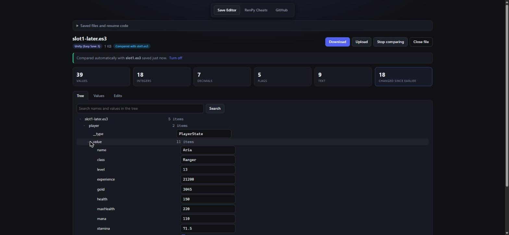
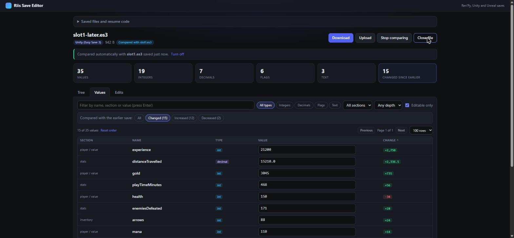
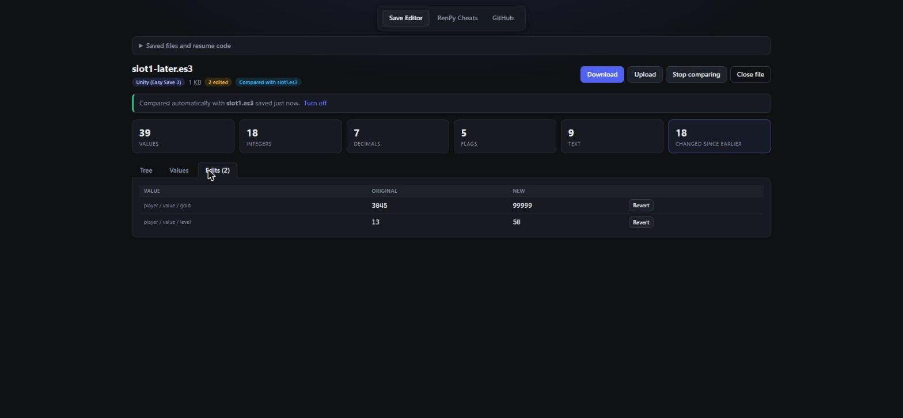
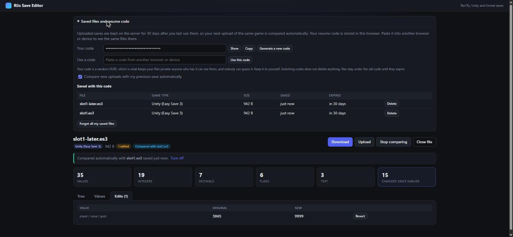

# RiisSaveEditor

[](https://opensource.org/licenses/MIT)
[](https://dotnet.microsoft.com/)
[](https://learn.microsoft.com/dotnet/csharp/)
[](https://docs.docker.com/compose/)
[](https://github.com/RiisDev/RiisSaveEditor/commits)

> [!IMPORTANT]
> This project is mostly AI-built and is a personal project, made for my own use. I could not find a well-made save editor that you can self-host, so I built this one. Sorry that it is vibe-coded slop. It works for my saves and tested from variants 6.99 to 8.4, but expect rough edges, and please report anything that breaks. This may have been vibe slopped, but I am a C# developer mainly and it was not given over blindly and everything was code reviewed.

## Description

RiisSaveEditor is a browser-based save editor for games built with Ren'Py, Unity (Easy Save 3), Unreal Engine, RPG Maker MZ and Godot (JSON saves). Open a save, change values in a tree or a sortable table, compare against an earlier save to see what increased or decreased, then download the edited file with the same name and format.

Saves are parsed and edited in memory, and no third-party parsing packages are used: the pickle, GVAS and Easy Save readers and writers are part of this repository. Uploaded saves are also cached on the server so later uploads can be compared automatically (see Saved files below).

### Screenshots

The previews below use an invented demo save. Click a title to expand it.

<details>
<summary>Tree view: browse and edit every value, with lazy loading and search</summary>



</details>

<details>
<summary>Values view: filter by type, section or depth, and see what increased or decreased since an earlier save</summary>



</details>

<details>
<summary>Edits tab: every change made in the session, with a one-click revert</summary>



</details>

<details>
<summary>Saved files and resume code: your earlier saves, kept for 30 days and used for automatic comparison</summary>



</details>

### Features

- Tree view for browsing every value in the save, with lazy loading for very large files and a search box.
- Values view with a flat, sortable table, type filters (integers, decimals, flags, text), section and depth filters, text search and paging.
- Compare with an earlier save to list changed, increased and decreased values with a `+` or `-` delta on each row, sorted by size of change.
- Edits tab that lists every change made in the session, with a one-click revert.
- Edits are written back byte-for-byte: only the values you changed are re-encoded, everything else in the file is preserved.
- Automatic comparison: upload a save and it is compared with your previous save of the same game, with no extra step.
- Password prompt for encrypted saves, plus an optional private list of known game passwords so those saves open without a prompt.
- Password recovery for encrypted Unity saves: upload the game's `global-metadata.dat` or `Assembly-CSharp.dll` (up to 128 MB) and every string found in it is tried as the password, in parallel, with a live progress bar. A password that works is remembered under your resume code like a typed one.

### Supported formats

| Engine | Files | Notes |
| --- | --- | --- |
| Ren'Py | `.save` and `persistent` | Python 2 and Python 3 pickles, protocols 2 to 5. Edited saves are re-signed with a key owned by the editor. Round-trip tested on 4,968 saves and persistent files from Ren'Py 6.99 to 8.4. |
| Unity | Easy Save 3 `.es3` | Plain JSON, gzip, and AES-encrypted files. The original formatting quirks are reproduced so unedited files round-trip exactly. |
| Unity | Save Game Free | JSON saves wrapped in base64 and encrypted with a 256-bit-block Rijndael cipher (PBKDF2-SHA1 key), as written by the Save Game Free asset. The password is a per-game secret, so it is not in the code: put the passwords of the games you host, one per line, in `App_Data/known-passwords.txt`, type the password when asked, or recover it from the game's own files (see below). Unedited saves are returned byte-for-byte; edited saves are re-encrypted with a fresh salt and IV. |
| Unreal Engine | GVAS `.sav` | UE 5.5 and later layout verified on UE 5.7 saves. The older layout (UE 4 to 5.4) is implemented and self-tested. |
| RPG Maker MZ | `.rmmzsave` | The zlib-compressed JSON is unpacked for editing. An unedited file is returned byte-for-byte; an edited file is recompressed, so the compressed bytes differ but the game reads it normally. MV `.rpgsave` is not supported. |
| Godot and plain JSON | `.json` | Only edited values are rewritten; indentation, key order and number spelling are untouched. |

Saved files. Every save you open (and every edited file you download) is kept on the server so your next upload of the same game can be compared against it. A cached file expires 30 days after it was last used; each time it is used as a baseline the 30 days start again. An hourly job deletes expired files, and size limits apply (5 snapshots per game, 200 MB per code, 5 GB overall).

There are no accounts. The first visit generates a random GUID, stored in the browser (`localStorage`), and its hash names the folder holding your files. Anyone who has the code can see the files saved under it, and it cannot be guessed. Paste the code into another browser or device to see the same files there, or generate a new one at any time. The "Saved files and resume code" panel lists, deletes and forgets the cached files. A password you type for an encrypted save is remembered under your code the same way, so the next upload of that game opens without asking; "Forget saved passwords" in the panel removes them, and forgetting all saved files removes them too. An earlier save is matched to a new upload by overlap of the variable and property names, and a downloaded edited save becomes the preferred baseline for the next upload.

Password recovery. When an encrypted Unity save asks for a password you don't know, drop the game's `global-metadata.dat` (from `<Game>_Data/il2cpp_data/Metadata`) or `Assembly-CSharp.dll` onto the second box that appears, up to 128 MB. Every printable string in the file (and, for the DLL, every UTF-16 string in its managed string heap) is tried as the password in parallel across all CPU cores, with a progress bar while it runs. This never leaves the server: nothing is uploaded anywhere else, and the uploaded file itself is not kept. A password that works is remembered under your resume code exactly as a typed one would be, so you only need to do this once per game.

Ren'Py signing. Ren'Py 7.6 and later sign each save. An edited save cannot keep the original signature, so it is re-signed with a key that belongs to your resume code. Ren'Py then shows its "save created on another device" prompt once, and accepting it trusts that key for later saves. Every code has its own key, so a save edited under someone else's code is never trusted by your game.

Security. Saves are treated as untrusted input. They are parsed into a tree and never executed: pickle data is read as plain values, global and object opcodes become inert nodes, and nothing is loaded, instantiated or run by name. Decompressed size (128 MB), nesting depth and value count are capped so a small crafted file cannot exhaust memory or overflow the stack, and a damaged file is rejected with an error. Ren'Py itself runs pickles when a game loads a save, so only load saves into a game that you got from someone you trust. The editor has no accounts and no rate limiting, so if you expose it beyond your own machine, put it behind a reverse proxy that provides HTTPS, authentication and request limits.

Known limits

- The Easy Save 3 encryption follows the documented scheme (AES-128-CBC, PBKDF2-SHA1 key) and is verified against self-made files only. Report a real encrypted save that fails.
- Unreal saves from before UE 5.5 are verified against re-encoded files only, not against real legacy saves.
- Values can be edited but not added or removed. Objects referenced from several places in a Ren'Py save show as read-only references.
- Comparing against an encrypted earlier save is not supported yet.
- Cached saves can contain personal data such as player names. They are stored unencrypted on the server disk, so run this only where you trust the host.

## Code Stack

- C# on .NET 10
- Blazor Server (interactive server rendering), no CSS framework
- Hand-written (AI Written I wont lie) parsers: Python pickle (protocols 2 to 5), Unreal GVAS, Easy Save 3 writer
- `System.Text.Json` for reading Easy Save JSON
- .NET base library for zip, gzip, AES and ECDSA
- Docker and Docker Compose for containerised hosting
- No NuGet package dependencies

## Requirements

- Docker Desktop (or any Docker Engine with Compose) for the Quick Start
- .NET 10 SDK to build and run from source

## Quick Start

```bash
docker compose up -d --build
```

Open <http://localhost:8080>, drop a save file onto the page and start editing.

```bash
docker compose down        # stop
docker compose down -v     # stop and delete the session keys and all cached saves (signing keys included)
```

The port is published on loopback only (`127.0.0.1:8080`); change that mapping and add a reverse proxy with HTTPS and authentication before exposing it. The container also runs with a read-only root filesystem, no Linux capabilities, `no-new-privileges` and a 4 GB memory limit. The container runs as a non-root user. The web app's session keys, the cached saves and each code's Ren'Py signing key are stored in the `save-editor-data` volume mounted at `/app/App_Data`, so they survive restarts.

## Build Steps

Build and run from source:

```bash
dotnet build
dotnet run --launch-profile http
```

The development server listens on <http://localhost:5149>.

Publish a release build:

```bash
dotnet publish -c Release -o publish
```

Run the self-checks. The checks project loads every file in a folder, saves it untouched and requires the bytes to match, then edits a value, saves, reloads and compares the whole tree. It also tests encryption, the legacy Unreal layout and the compare logic:

```bash
dotnet run --project Checks -- <folder with saves> --edit
```

| Option | Effect |
| --- | --- |
| `--edit` | Also run the edit and reload round trip on every file. |
| `--only <text>` | Only check files whose path contains the text. |
| `--list <file>` | Read the files to check from a text file, one path per line. |
| `--sig` | Verify which hash the example Ren'Py signature uses. |
| `--write-fixture` | Write an encrypted Easy Save test file to `Checks/fixtures`. |
| `--recover <save> <metadata>` | Manually run password recovery against a real save and a real `global-metadata.dat`/`Assembly-CSharp.dll`, outside the browser. |
| `--expect <password>` (with `--recover`) | Check that extraction finds this exact string, and report its position. |
| `--extract-only` (with `--recover --expect`) | Stop after the extraction check instead of also running the full brute force. |

The checks can also run on Linux inside a container:

```bash
docker run --rm -v "$PWD:/src:ro" mcr.microsoft.com/dotnet/sdk:10.0 sh -c \
  'cp -r /src /work && cd /work && rm -rf obj bin Checks/obj Checks/bin && dotnet run --project Checks -- /work/SAVE_EXAMPLES --edit'
```

### Releases

The `Release` workflow runs only when a tag named `vMAJOR.MINOR.BUGFIX` is pushed (for example `v1.2.0`) or when started manually from the Actions tab with a version. It publishes a GitHub release with six downloads, plus a container image at `ghcr.io/riisdev/riissaveeditor` tagged with the version and `latest`.

| Download | Contents | Needs .NET installed |
| --- | --- | --- |
| `single-file` (linux-x64, win-x64) | One executable with the runtime inside, plus `wwwroot` | No |
| `self-contained` (linux-x64, win-x64) | Loose files with the runtime | No |
| `framework-dependent` (linux-x64, win-x64) | Loose files, smallest | Yes, the .NET 10 ASP.NET runtime |

Linux downloads are `.tar.gz`, Windows downloads are `.zip`. Keep each download's `wwwroot` folder next to the executable.

Setup: add a repository secret named `RELEASE_TOKEN` holding a personal access token with the `contents: write` permission on this repository, so the release is created by your account instead of `github-actions`. The container image uses the built-in `GITHUB_TOKEN`.

## AI Disclosure

Parts of this project were developed with AI assistance. Below is a summary of where it was used:

- Saves/Pickle.cs, Saves/RenpyFormat.cs - Python pickle reader and in-place writer, Ren'Py save and persistent formats, signing, protocol 4 and 5 frame handling
- Saves/GvasFormat.cs - Unreal GVAS reader and writer for both property tag layouts
- Saves/UnityEs3Format.cs - Easy Save 3 reader and writer, gzip and AES encryption support
- Saves/SaveGameFreeFormat.cs, Saves/RijndaelCipher.cs - layered encrypted JSON saves and a 256-bit-block Rijndael implementation
- Saves/PasswordRecovery.cs - string extraction and parallel brute-force password recovery from game metadata/assembly files
- Saves/JsonText.cs, Saves/PlainJsonFormat.cs, Saves/RpgMakerFormat.cs - span-preserving JSON editor, Godot JSON saves and RPG Maker MZ saves
- Saves/SaveFormat.cs, Saves/SaveTree.cs - shared node model, format registry, statistics and compare logic
- Saves/SaveCache.cs, CacheCleanup.cs - 30-day saved-files cache, GUID resume codes, similarity matching and expiry
- Components and wwwroot - Blazor pages, tree and values views, saved-files panel, dashboard layout and styling
- Checks - round-trip, edit, encryption, legacy layout, compare, cache and security regression checks
- Saves/SafeIo.cs, Saves/JsonText.cs depth limits and the security audit fixes - bounded decompression, nesting limits, per-code signing keys
- Dockerfile, compose.yaml, .dockerignore - container packaging
- .github/workflows/release.yml - release workflow for binaries and the container image
- README generation - documentation written with AI assistance based on source code

## License

This project is licensed under the MIT License.
